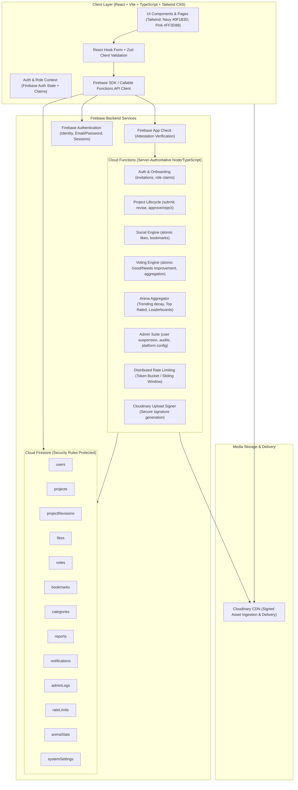

# PROJECT HUB — Master Architecture Specification

## 1. System Overview & Architecture Diagram

PROJECT HUB is an enterprise-grade, secure, private company-wide Project Showcase and Community Platform. The architecture separates untrusted client rendering from server-authoritative mutations, validation, voting integrity, and security checks.



## 2. Technology Stack & Component Responsibilities

| Layer | Technology | Key Responsibilities |
|---|---|---|
| **Frontend Framework** | React 18+, TypeScript, Vite | Single-Page Application, fast HMR, strict type safety |
| **Styling & Design System** | Tailwind CSS v3/v4 | Custom theme tokens: Navy (`#0F1B3D`), White (`#FFFFFF`), Hot Pink (`#FF3D88`), Near Black (`#111111`). Space Grotesk, Inter, JetBrains Mono |
| **Form & Validation** | React Hook Form, Zod | High-performance, schema-driven validation for project submissions, user profiles, admin settings |
| **Routing & Navigation** | React Router DOM v6 | Role-based protected routes (`SUPER_ADMIN`, `ADMIN`, `EMPLOYEE`), layout composition |
| **Authentication** | Firebase Authentication | Email/password, password resets, session persistence, token refreshes, custom claims |
| **Database** | Cloud Firestore | Scalable NoSQL storage, atomic transactions, subcollections/normalized link tables, granular security rules |
| **Server Logic** | Firebase Cloud Functions (Node.js 20 TS) | Server-authoritative business operations: atomic voting, revisions, like counters, approval workflows, Cloudinary signature generation |
| **Asset Management** | Cloudinary | Signed secure image uploads for covers, screenshots, and avatars; automated optimizations and transformations |
| **Attestation & Security** | Firebase App Check & Firestore Rules | Rejection of unauthorized callers, defense-in-depth authorization, rate limiting |
| **Hosting** | Vercel (Web Client) / Firebase (Functions & DB) | High-speed global edge distribution, seamless CI/CD |

## 3. Modular Folder Structure

```
e:/tehyprojects2/
├── docs/
│   ├── ARCHITECTURE.md
│   ├── DATABASE_SCHEMA.md
│   ├── SECURITY.md
│   └── DEVELOPMENT_PHASES.md
├── .env.example
├── firebase.json
├── firestore.rules
├── firestore.indexes.json
├── package.json
├── tsconfig.json
├── vite.config.ts
├── tailwind.config.js
├── src/
│   ├── app/
│   │   ├── App.tsx
│   │   ├── main.tsx
│   │   ├── config.ts
│   │   └── firebase.ts
│   ├── components/
│   │   ├── common/         (Buttons, Badges, Modals, Loaders, Toasts, EmptyStates)
│   │   ├── feedback/       (Alerts, ConfirmationDialogs, SkeletonLoaders)
│   │   └── navigation/     (Navbar, Sidebar, MobileDrawer, Breadcrumbs)
│   ├── layouts/
│   │   ├── AppLayout.tsx
│   │   ├── AuthLayout.tsx
│   │   └── AdminLayout.tsx
│   ├── features/
│   │   ├── authentication/ (LoginForm, ResetPasswordForm, AuthGuard, RoleGuard)
│   │   ├── dashboard/      (EmployeeOverview, ActivityFeed, QuickActions)
│   │   ├── projects/       (ProjectCard, ProjectDetails, ProjectSubmitForm, RevisionDiff)
│   │   ├── explore/        (ProjectFilterBar, SearchInput, CategorySelector, ProjectGrid)
│   │   ├── arena/          (LeaderboardTabs, RankingCard, TrendingMetric, VoteThresholdNotice)
│   │   ├── voting/         (VoteButtonPair, VotePercentageBar, VoteBreakdownModal)
│   │   ├── bookmarks/      (BookmarkList, BookmarkToggle)
│   │   ├── profiles/       (EmployeeDirectory, ProfileHeader, PortfolioGrid, EditProfileModal)
│   │   ├── admin/          (ReviewQueue, EmployeeManager, CategoryEditor, ReportsList, AuditLogViewer, SettingsEditor)
│   │   └── notifications/  (NotificationBell, NotificationList, NotificationItem)
│   ├── hooks/              (useAuth, useProjects, useVoting, useDebounce, useRateLimit)
│   ├── services/           (authService, projectService, interactionService, cloudinaryService, adminService)
│   ├── repositories/       (firestore repositories for normalized data access)
│   ├── schemas/            (Zod schemas for project, profile, auth, settings)
│   ├── types/              (TypeScript domain definitions, DTOs, Enums)
│   ├── utils/              (dateFormatter, percentageCalculator, trendingScorer, sanitizer)
│   ├── constants/          (roles, statuses, categories, navigationItems, themeTokens)
│   └── routes/             (AppRoutes.tsx, routeConfig.ts)
└── functions/
    ├── package.json
    ├── tsconfig.json
    └── src/
        ├── index.ts
        ├── auth/           (onUserCreated, setEmployeeRole, inviteEmployee)
        ├── projects/       (submitProject, submitRevision, reviewProject, archiveProject)
        ├── likes/          (toggleLike, getLikeStatus)
        ├── votes/          (castVote, retractVote, computeVoteAggregates)
        ├── bookmarks/      (toggleBookmark)
        ├── moderation/     (submitReport, resolveReport)
        ├── rate-limits/    (slidingWindowLimiter, checkRateLimit)
        ├── notifications/  (dispatchNotification, markAsRead)
        ├── admin/          (updatePlatformSettings, logAdminAction, manageUserStatus)
        ├── analytics/      (computeArenaStats, refreshTrendingScores)
        └── cloudinary/     (generateUploadSignature)
```

## 4. Architectural Decisions & Principles

1. **Server-Authoritative Social & Voting Actions**:
   - To eliminate race conditions, double-voting, self-voting, and fabricated vote tallies, voting and likes are processed via Cloud Functions using Firestore transactions.
   - Aggregate statistics (`likeCount`, `goodVoteCount`, `needsImprovementVoteCount`, `totalValidVotes`, `goodPercentage`) are computed and stored directly on the project document and in `arenaStats`.
2. **Dual-State Revision Pattern**:
   - When an approved project receives major modifications, the existing live project remains untouched in `projects/{projectId}`.
   - A revision draft is created in `projectRevisions/{revisionId}` with status `PENDING_REVIEW`.
   - Once an administrator approves the revision, its updates are merged atomically into `projects/{projectId}`, and the revision is marked `APPLIED`.
3. **Decoupled Arena Ranking Engine**:
   - Top Rated is strictly gated by a configurable threshold (default: $\ge 10$ valid votes) to prevent skew from single 100% scores.
   - Trending ranking implements a time-decay algorithm balancing unique voters, recent likes, and freshness without mixing like counts and vote scores arbitrarily.
4. **Zero Frontend Secret Exposure**:
   - Cloudinary upload signatures are generated on the server using signed tokens with constrained folders, sizes, and timestamp expiration. The Cloudinary API secret is never bundled into client assets.

